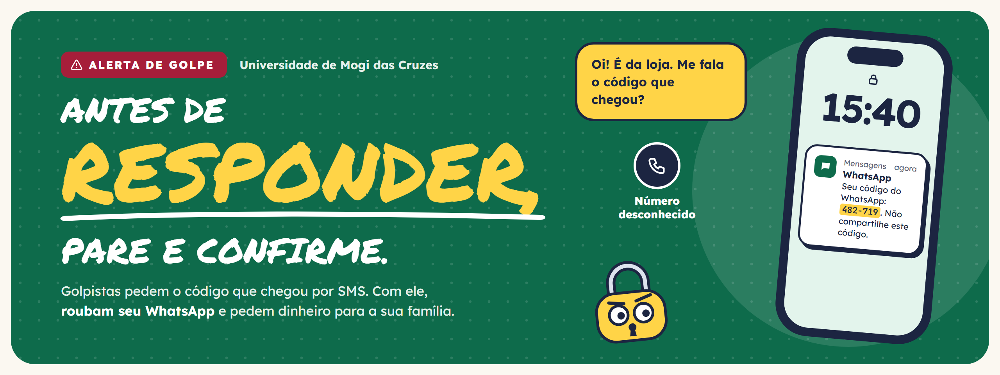
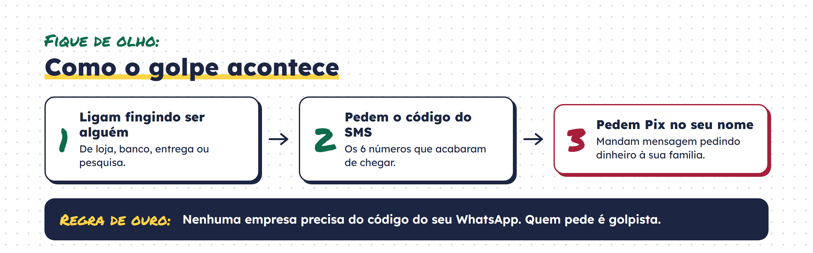
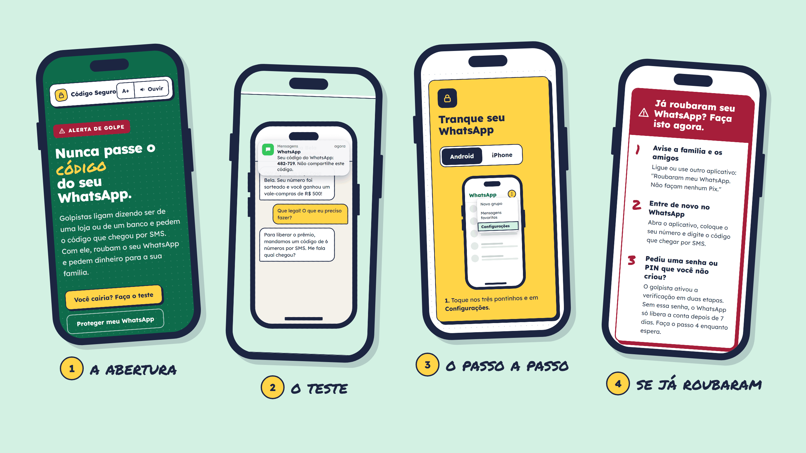

<p align="center">
  
</p>

<p align="center">
  Um <b>site</b> e um <b>panfleto</b> para ensinar pessoas mais velhas e suas famílias<br>
  a não cair no golpe do código do WhatsApp.
</p>

<p align="center">
  
  
  
  
  
</p>

## O golpe



## O site

Feito para ser aberto no celular, depois de receber o panfleto. Tudo em português simples, sem termo técnico.



- **Simulador:** uma conversa de golpe dentro de um celular. A pessoa escolhe o que responder e vê o que acontece.
- **Tranque seu WhatsApp:** o passo a passo da verificação em duas etapas no Android e no iPhone, com as telas do app.
- **Já roubaram?** O que fazer na hora, com o e-mail pronto para o suporte do WhatsApp.
- **Família:** como conversar com os mais velhos sem dar bronca.

## Pensado para quem tem mais idade

- **A+** aumenta o texto do site inteiro, e **Ouvir** lê em voz alta a parte que está na tela.
- Botões grandes, contraste alto e foco visível para quem usa o teclado.
- Nenhum dado é coletado: sem cadastro, sem formulário, sem rastreamento.

## Rodando o projeto

```bash
npm install
npm run dev     # abre o site no endereço que aparecer no terminal
npm run build   # gera a versão final em dist/
```

<details>
<summary><b>Estrutura das pastas</b></summary>

```
src/
├── components/   cabeçalho, rodapé, celular do panfleto, ícones e botões
├── sections/     uma parte da página por arquivo (abertura, simulador, proteção...)
├── hooks/        A+, leitura em voz alta e copiar texto
├── lib/          roteiro do simulador e leitura da seção visível
├── styles/       cores e estilos, tirados do panfleto
└── types/        tipos compartilhados

public/panfleto/  frente e verso do panfleto
docs/             imagens deste README
```

</details>

## Quem fez

**[Mauro Junior](https://github.com/mj01px)**, **[Pablo de Souza](https://github.com/1pablex)**, **Matheus Henrique** e **Victor Teixeira**<br>
Engenharia de Software, 8B Noturno · Universidade de Mogi das Cruzes · 2026
