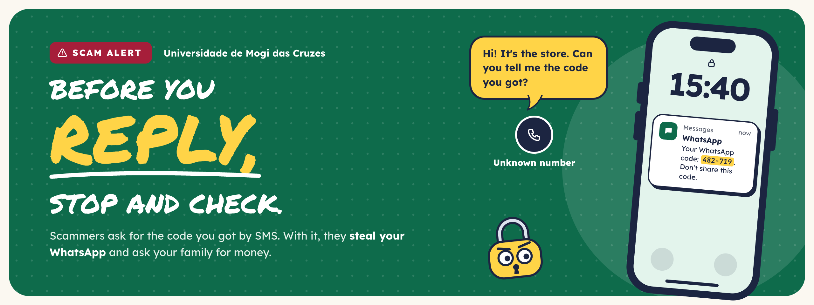
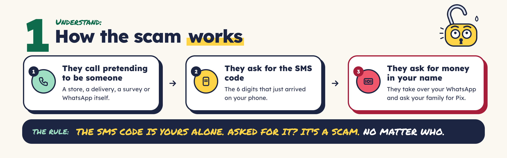
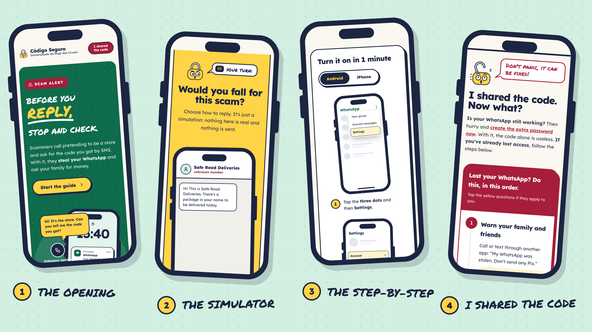

<p align="center">
  
</p>

<p align="center">
  A <b>website</b> and a <b>flyer</b> that teach older adults and their families<br>
  not to fall for the WhatsApp verification code scam.
</p>

<p align="center">
  
  
  
  
  
</p>

> The website and the flyer are in Brazilian Portuguese, since they were made for a Brazilian audience.

## The scam



## The website

Designed to be opened on a phone after receiving the flyer. Everything is written in plain language, with no technical jargon.



- **Simulator:** a scam conversation inside a phone. The user chooses how to reply and sees what happens.
- **Lock down your WhatsApp:** a step-by-step guide to two-step verification on Android and iPhone, with screenshots of the app.
- **Already hacked?** What to do right away, with a ready-to-send email for WhatsApp support.
- **Family:** how to talk to older relatives without scolding them.

## Built for older users

- **A+** enlarges the text across the whole site, and **Listen** reads the visible section aloud.
- Large buttons, high contrast, and a visible focus indicator for keyboard users.
- No data is collected: no sign-up, no forms, no tracking.

## Running the project

```bash
npm install
npm run dev     # opens the site at the address shown in the terminal
npm run build   # builds the production version into dist/
```

<details>
<summary><b>Folder structure</b></summary>

```
src/
├── components/   header, footer, flyer phone, icons, and buttons
├── sections/     one page section per file (opening, simulator, protection...)
├── hooks/        A+, read-aloud, and copy text
├── lib/          simulator script and visible-section reading
├── styles/       colors and styles, taken from the flyer
└── types/        shared types

public/panfleto/  front and back of the flyer
docs/             images for this README
```

</details>

## Authors

**[Mauro Junior](https://github.com/mj01px)**, **[Pablo de Souza](https://github.com/1pablex)**, and **[Victor Teixeira](https://github.com/VTNz19)**<br>
Software Engineering, 8B Evening · Universidade de Mogi das Cruzes · 2026
